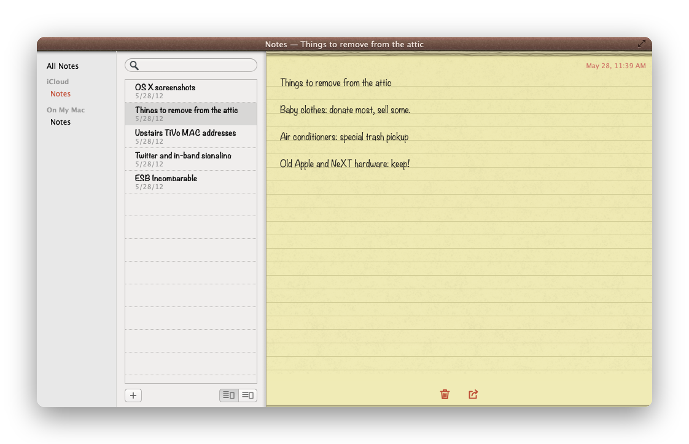
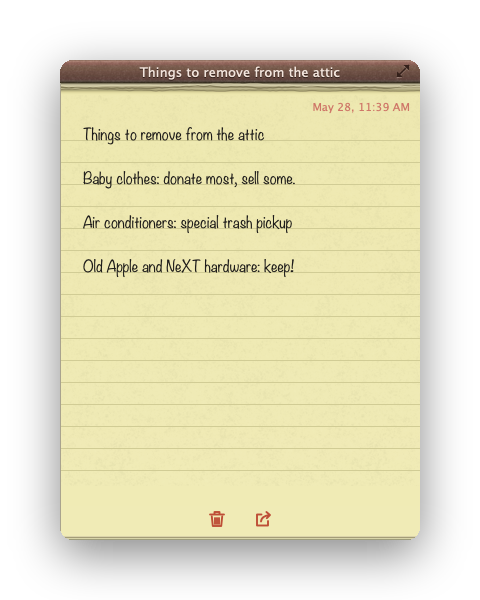

# RetroNotes

A native macOS recreation of **Notes from OS X 10.8**: leather header, yellow lined paper, traffic lights. No mock-up and no database of its own – accounts, folders and notes are read from the system *Notes* app via its scripting interface (JXA/osascript) and written back to it.

<p align="center"></p>

> Swift 5.9 · AppKit · macOS 14 or later · English and German · GPL-3.0
>
> **Note:** RetroNotes is an independent project and is not affiliated with Apple Inc. The design is *inspired by* OS X 10.8. Apple, Mac, macOS, OS X and Mountain Lion are trademarks of Apple Inc.

## Features

- **Your real notes** – accounts, folders and notes come from the system Notes app; changes are written back, nothing is copied into a private store.
- **Skeuomorphic UI** – leather title bar, torn-paper edge, lined paper, sidebar with accounts and folders, list of notes.
- **Rich-text editor** – formatted text is converted between the system Notes HTML and the editor (self-test: `-selftest`).
- **Single-note windows and full-screen** – open a note in its own window or work in full-screen.
- **Image attachments** – drag and drop or insert PNG, JPEG, GIF and TIFF (up to 20 MP) into a note; Notes stores them as real attachments.
- **Backup and restore** – *File › Back up all notes …* writes a folder with `manifest.json` (schema 1) plus one unchanged `.html` per note under `Account/Folder/`; *Restore from backup …* re-creates missing notes (by ID) and missing folders.
- **Search** – across the first 2000 characters of each note.
- **Privacy** – all data stays in the system Notes app; RetroNotes makes no network connections and asks for Automation access to Notes on first launch.

## Screenshots

<table>
<tr>
<td></td>
<td></td>
</tr>
<tr><td align="center">Main window</td><td align="center">Single-note window</td></tr>
</table>

*All images show demo data (`-demo`), not real notes. Re-create them with `build/RetroNotes.app/Contents/MacOS/RetroNotes -demo -select=1 -snap=out.png -quit`.*

## Installation

Download the signed and notarized DMG from the [latest release](../../releases), open it and drag the app to *Applications*. Requires macOS 14 or later (Apple Silicon and Intel). On first launch macOS asks once for permission to control the Notes app.

## Build from source

```bash
./build.sh                        # builds build/RetroNotes.app
./release.sh                      # Developer ID + hardened runtime → notarize → DMG (add "publish" for a GitHub release)
Reference/make_assets.py          # re-generate textures and app icon
```

`release.sh` needs a "Developer ID Application" certificate in the keychain and a `notarytool` profile (`NOTARY_PROFILE`, default `Retromac`). Entitlements: Apple Events/Automation only (`Resources/RetroNotes.entitlements`).

## Testing

```bash
APP=build/RetroNotes.app/Contents/MacOS/RetroNotes
$APP -selftest                                    # HTML ↔ rich-text round trip
$APP -demo -select=1 -snap=/tmp/x.png -quit       # demo data, PNG at 1 px/pt (also -single, -full, -size=WxH, -delay=s)
python3 Reference/compare.py /tmp/x.png           # pixel comparison against the reference (notes-big.png), optional crop and zoom
$APP -backup=PATH   /   $APP -restore=PATH        # test hooks for backup and restore
```

Dimensions (1×, measured from the reference): leather header 22, traffic lights Ø12 / pitch 20 / center y=11, sidebar 130, list 239 (row 37), line grid 22, default window 736×443, single note 360×480.

## Data & privacy

RetroNotes has no database of its own. Notes live in the system Notes app (iCloud, On My Mac, …); the app only reads and writes them through Automation. Backups are plain folders you choose. No network access.

## Limitations

- Notes with attachments, tables or password protection are **read-only** (saving would damage them in Notes).
- Checklists, tables and font families are not written back to the HTML.
- Only images can be attached; other file types cannot be created through the scripting interface (the app says so instead of dropping them silently). Existing attachments cannot be read, and an inserted image no longer shows in the editor after an app restart (it is kept in Notes).
- Backups do not contain attachments (not readable) or password-protected notes; both are listed in the manifest and in the final dialog.
- Restoring only adds missing notes and folders; it never overwrites existing ones.
- Minimum window sizes (619×300, without folders 489×300; single note 250×180) are assumptions, not measured on the original.

## License & legal

- **Code:** [GNU General Public License v3.0](LICENSE) (GPL-3.0). Copyright © 2026 Maik Klotz.
- **No affiliation with Apple:** RetroNotes is an independent open-source project, neither authorized nor endorsed by Apple. No Apple images, fonts, sounds or textures are included (reference screenshots and system fonts such as Noteworthy, Marker Felt and Lucida Grande are not part of the repository; fonts come from the installed system). Apple, Mac, macOS, OS X and Mountain Lion are trademarks of Apple Inc.
- **App icon:** `Resources/icon-source.png` and `AppIcon.icns` are AI-generated (Gemini) and are **not** covered by the GPL; all rights reserved. Forks should use their own icon.
- **Distribution:** GitHub only (source and notarized releases), not the App Store.
